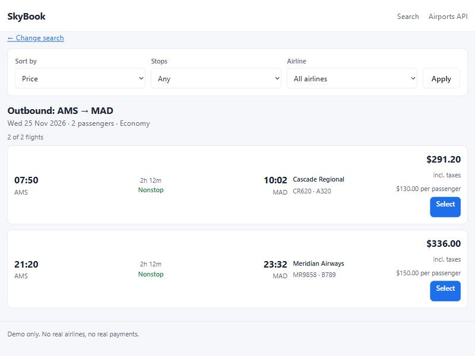
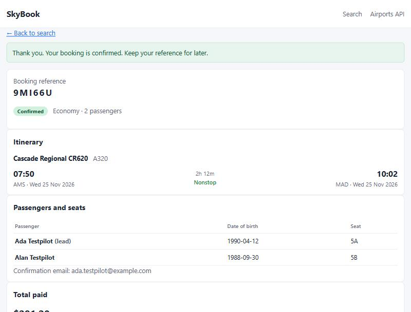
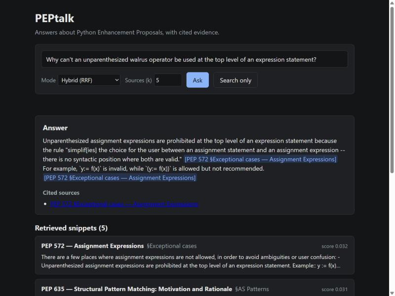

# Agensh × Claude Code (Claude Haiku 5.5): two team runs

A hands-on test of [microsoft/Agensh](https://github.com/microsoft/Agensh), a decentralized multi-agent harness
([paper](https://arxiv.org/abs/2609.26781)). In Agensh, a team of coding agents coordinates through
[Gitea](https://about.gitea.com/) (repository, issues, pull requests, CI), [Mattermost](https://mattermost.com/)
(chat) and a shared board, with no central orchestrator. Here every worker is
[Claude Code](https://github.com/anthropics/claude-code) 2.1.327 running **Claude Haiku 5.5** (`claude-haiku-5-5`),
using Agensh's built-in Claude Code adapter (`--agent-harness claude`).

Two projects, run in parallel on one WSL2 machine, each with 4 workers and a 1.5-hour budget:

| Run | Task | Seed | Coordination |
|---|---|---|---|
| `plane-tickets` | Build **SkyBook**, a flight booking web app: search, seats, passengers, mock payment, booking lookup and cancel ([goal](plane-tickets/goal.md)) | empty repository | planning phase on (worker 1 plans first) |
| `pep-rag` | Build **PEPtalk**, retrieval-augmented question answering over 69 Python PEPs: BM25, dense and hybrid retrieval, Claude answers with citations, web UI, retrieval eval ([goal](rag/goal.md)) | the PEP corpus ([seed script](rag/make_seed.py)) | self-organized (no planning phase) |

**Status: both runs finished and were checked by hand.** Full write-up: [reports/run-report.md](reports/run-report.md).
Generated numbers: [reports/stats.md](reports/stats.md).

| | SkyBook (plane tickets) | PEPtalk (RAG) |
|---|---|---|
| PRs merged / delivered commits | 18 / 41 | 18 / 48 |
| Agensh acceptance on the delivered head | pass, 228 tests | pass, 166 tests |
| Model requests (`claude-haiku-5-5`, 0 errors) | 971 | 1010 |
| Cost (5-min / 1-h cache-write pricing) | $1.73 / $2.02 | $1.34 / $1.58 |
| Manual check | full booking flow works in a browser | cited answers; retrieval eval reproduces exactly (hybrid hit@5 1.000, MRR 0.963 on the team's own 83 questions) |

| SkyBook: results | SkyBook: confirmed booking | PEPtalk: cited answer |
|---|---|---|
|  |  |  |

The delivered code is in [`plane-tickets-app/`](plane-tickets-app/) and [`pep-rag-app/`](pep-rag-app/). Caveats: one run per task,
no single-agent baseline, and PEPtalk's eval questions were written by the same agents (see the report's Limitations).

## Findings

- **Install works on WSL2 Ubuntu 24.04** with Docker Engine, systemd and cgroup v2. Agensh's scripts call `sudo docker` / `sudo -n`.
  Instead of adding a passwordless-sudo rule, everything runs as root (`wsl -u root`). 81/81 unit tests pass.
  Four tests first failed because `tests/smoke/fake_upstream.py` treats port `0` as unset and falls back to 8080,
  which another container was using here; `PORT=0` works around it.
- **Workspace-scoped API keys need a relay.** This API key is not tied to a workspace, so the Anthropic API requires an
  `anthropic-workspace-id` header on every request. Agensh's egress proxy (`scripts/strip_metadata_proxy.py`) can only
  inject `Authorization: Bearer`. [`relay/anthropic_relay.py`](relay/anthropic_relay.py) is a ~100-line stdlib relay on the
  Docker host gateway (the "host-loopback" pattern in Agensh's REPRODUCE.md) that adds the header and passes streams
  through. Agensh itself is unmodified.
- **Planning gate vs. Haiku (plane-tickets).** With `[coordination] planning = true`, worker 1 is told to open a PR titled
  `[plan] …`, and the other workers wake only when such a PR merges (`agensh/team_run.py`) or after 45 minutes.
  Haiku created an issue breakdown and merged feature PRs, but never used the `[plan]` title. Workers 2–4 therefore slept
  until the timeout: 2,809 s of the 5,400 s budget went to "waking", leaving the full team ~43 minutes.
  The RAG run uses `planning = false`, and all four workers woke within 101 s.
- **CI command pitfall (mine).** Gitea Actions runs `bash -e`, so `pytest; rc=$?; …` exits on pytest's
  "no tests collected" code 5 before the check runs. The empty first `main` failed CI, and Agensh's main-health gate allowed only
  `[fix-main]` PRs until worker 1 added a smoke test itself. The RAG seed repository ships a passing corpus test to avoid this.
- **Self-organization (RAG run).** Without a planning phase, the four Haiku workers split the work by issue within minutes:
  ingest + BM25, dense + hybrid retrieval, generation with citations, web UI/API, and the eval set.
  After 15 minutes they had 6 PRs merged through the CI gate, and they finished with 18 merges and no `main` breakage.
- **Memory, not tokens, was the bottleneck for two teams on one machine.** Each PEPtalk worker ran the app's CPU embedding
  (1.3–2.9 GB per process) to test its own changes, pushing the containers close to the `agensh.slice` limit. I paused the
  plane-tickets team (`python3 -m agensh.project pause`) and resumed it after PEPtalk delivered (`HOURS=0.55 … resume`).
  Pause and resume worked cleanly.

## How it is set up

```
Claude Code workers (4 per team, Docker)  ──►  Agensh egress proxy (injects Bearer key, meters usage)
          │  Gitea / Mattermost / board                    │
          ▼                                                ▼
   team repo, issues, PRs, CI              relay/anthropic_relay.py on 172.17.0.1:8788
                                            (Bearer → x-api-key, + anthropic-workspace-id)
                                                           │
                                                           ▼
                                                 api.anthropic.com (claude-haiku-5-5)
```

| File | Purpose |
|---|---|
| [`haiku.json`](haiku.json) | Agensh harness override: Claude Code 2.1.327, `claude-haiku-5-5`, effort `high`, 100K context window, compaction at 80% (keeps prompts under Haiku 5.5's 100K-token price tier) |
| [`plane-tickets/project.toml`](plane-tickets/project.toml), [`goal.md`](plane-tickets/goal.md) | Agensh `software-project` file and goal for SkyBook |
| [`rag/project.toml`](rag/project.toml), [`goal.md`](rag/goal.md), [`make_seed.py`](rag/make_seed.py) | PEPtalk project, goal, and the script that builds the seed repo: PEPs from [python/peps](https://github.com/python/peps) at a pinned commit, kept only if their Copyright section is public domain or CC0 |
| [`relay/anthropic_relay.py`](relay/anthropic_relay.py) | Header relay for workspace-scoped API keys, plus a **hard dollar cap** across all teams (tests: [`relay/test_anthropic_relay.py`](relay/test_anthropic_relay.py)) |

**Spend cap.** Agensh's `[budget] max_model_tokens` counts only uncached input + output tokens (`scripts/usage_meter.py`), not
cache reads/writes or dollars. Here, most traffic is cache reads, so that cap would not bound cost. Every model request passes through the relay, so it enforces the cap instead:
- It forwards only `claude-haiku-5-5`.
- Before forwarding, it reserves an upper bound of the request's cost: body bytes / 2 tokens, all priced as 1-hour cache writes, plus `max_tokens` of output.
- It refuses with 403 if spent + reserved would exceed `RELAY_SPEND_CAP_USD`. After the response, it settles the actual cost from the response's `usage`.
- Haiku 5.5 prices: $0.10 / $0.50 per MTok in / out (≤100K-token prompts; $0.50 / $2.50 above), cache reads 0.1×, 5-minute writes 1.25×, 1-hour writes 2×.
- For these runs the cap is **$9.00**. The ledger was seeded with the $2.83 spent before the cap existed, priced the same conservative way plus a $0.10 margin.

## Reproduce

Prerequisites: Linux (or WSL2) with Docker Engine + Compose v2, systemd, cgroup v2, Python 3.11+, git, curl, jq, envsubst,
flock, and root or passwordless sudo. Commands below run as root in WSL.

```bash
# 1. Agensh at the tested commit, plus its host units (REPRODUCE.md "Prerequisites")
git clone https://github.com/microsoft/Agensh.git && cd Agensh && git checkout 2dae4e14a653
cp docker/agensh.slice /etc/systemd/system/
sed "s|/opt/agensh|$PWD|g" docker/agensh_reboot_guard.service > /etc/systemd/system/agensh-reboot-guard.service
systemctl daemon-reload && systemctl enable agensh-reboot-guard.service
PORT=0 python3 -m unittest discover -s tests/unit

# 2. Relay (only for keys that need anthropic-workspace-id) and credentials
systemd-run --unit=agensh-anthropic-relay --setenv=ANTHROPIC_WORKSPACE_ID=wrkspc_... \
  python3 -u /path/to/relay/anthropic_relay.py
printf 'LLM_UPSTREAM=http://172.17.0.1:8788\nLLM_UPSTREAM_TOKEN=%s\n' "$ANTHROPIC_API_KEY" > ~/.agensh/upstream.env
chmod 600 ~/.agensh/upstream.env      # without the relay: LLM_UPSTREAM=https://api.anthropic.com

# 3. Build, profile, run (repeat for rag/project.toml after python3 -I rag/make_seed.py <seed-dir>)
H="--agent-harness claude --harness-version 2.1.327 --harness-config /path/to/haiku.json"
python3 -m agensh.project build   /path/to/plane-tickets/project.toml $H
WORKER_MEMORY=4g python3 -m agensh.project profile /path/to/plane-tickets/project.toml $H
python3 -m agensh.project run     /path/to/plane-tickets/project.toml
```

To watch a run: Gitea is at `http://localhost:<EDGE_HTTP_PORT>` and Mattermost at `http://localhost:<EDGE_MM_PORT>`
(ports are in the generated `.env.software-project-<name>`). For live token use per worker, run
`python3 scripts/team_status.py software-project-<name>`.

## Results layout

| Path | Content |
|---|---|
| `runs/<name>/` | Copied run records: `run_state`, `delivery`, `acceptance`, `main-health`, `prepare`, `sync` JSON, the proxy's `usage.jsonl`, the delivered first-parent `git-log.txt`, the rendered team prompts, and (PEPtalk) my reproduced eval results |
| [`runs/fetch_artifacts.sh`](runs/fetch_artifacts.sh) | Copies those records from the WSL checkout (no profiles, tokens or service logs) |
| [`reports/collect_stats.py`](reports/collect_stats.py) | Regenerates `reports/stats.md` / `stats.json` from `runs/` |
| `plane-tickets-app/`, `pep-rag-app/` | The delivered code, as exported by Agensh |

## To do

- [x] Collect results: `delivery.json`, `acceptance.json`, timeline, tokens and cost per team
- [x] Check the delivered apps: tests, SkyBook booking flow, PEPtalk retrieval + generation eval and UI
- [x] Write `reports/run-report.md` with screenshots
- [ ] Report upstream to microsoft/Agensh: the planning gate's dependence on the `[plan]` title, the `fake_upstream` port-0 quirk,
      and that `max_model_tokens` excludes cache tokens
- [ ] For a real comparison: a single-agent baseline (`workers = 1`, same budget, `fixed_length = true`), several seeds, and a
      held-out, human-written PEPtalk question set
