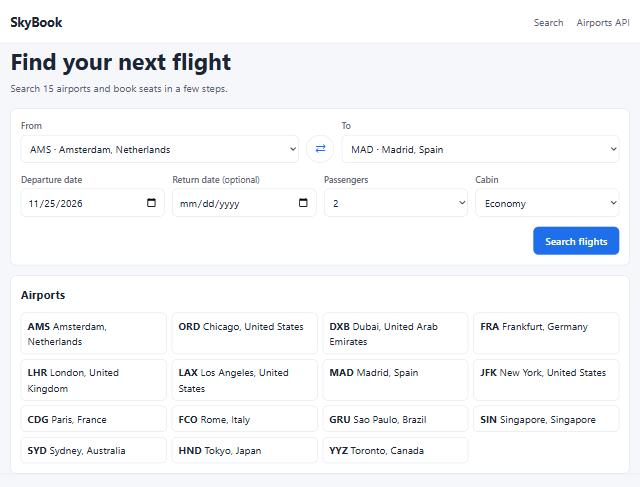
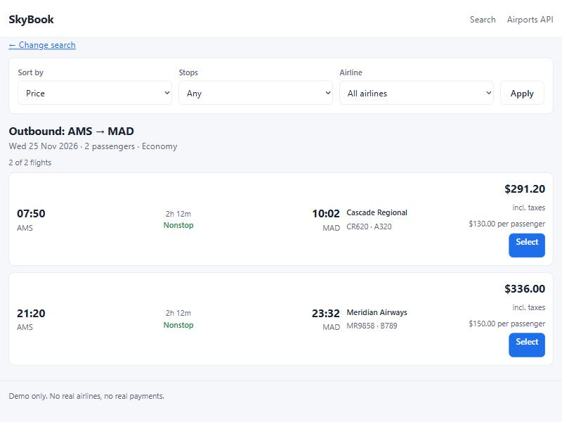
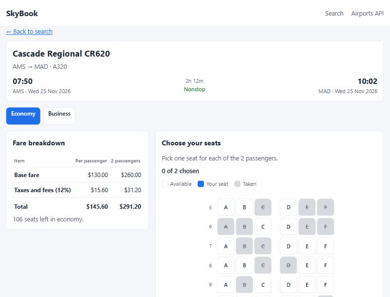
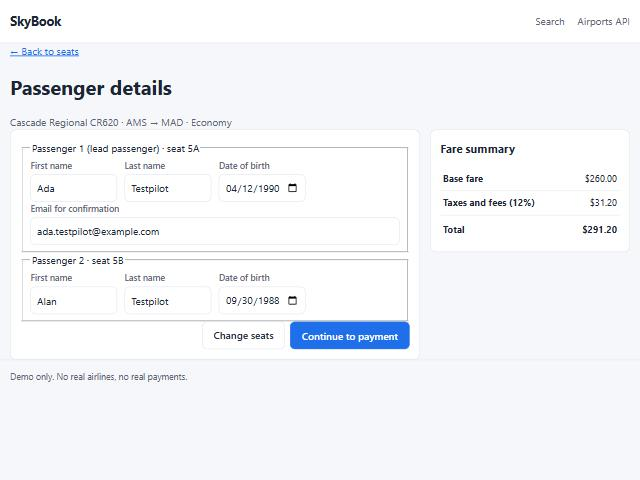
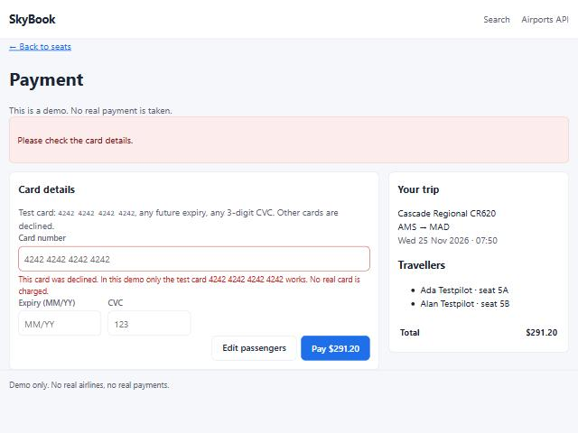
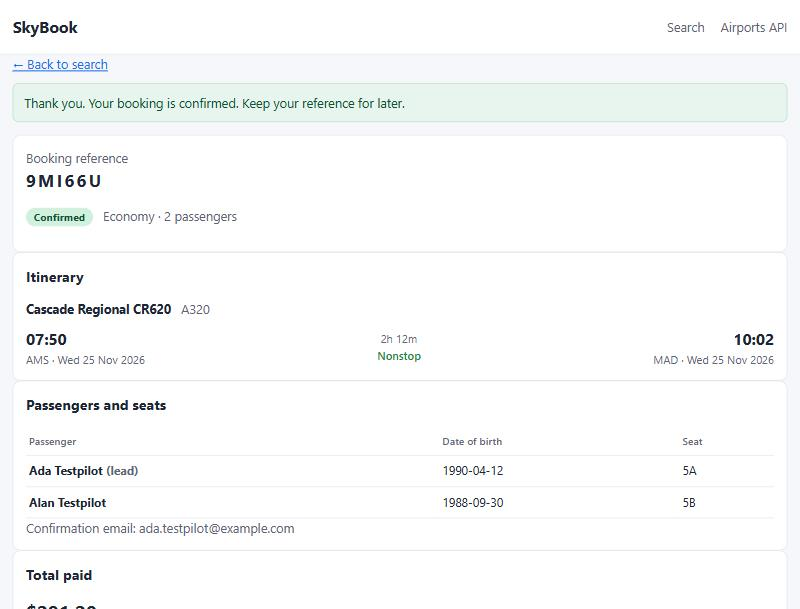
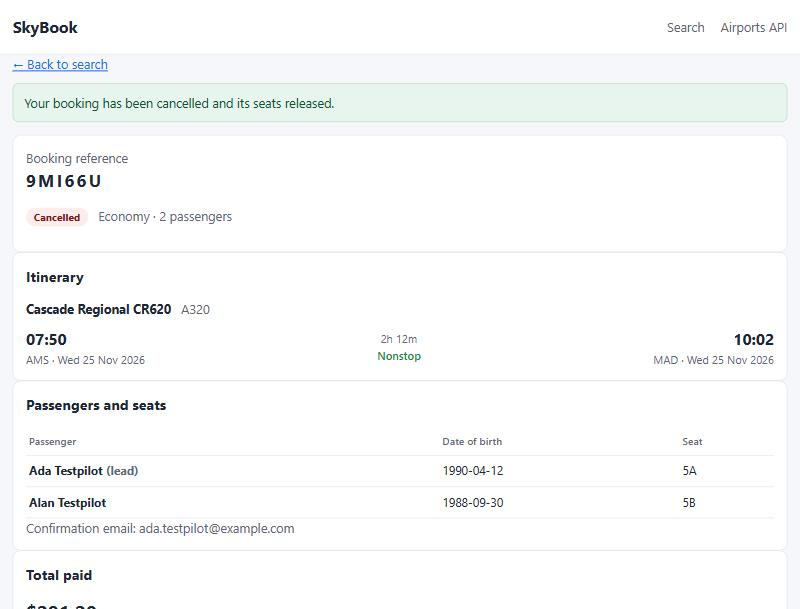
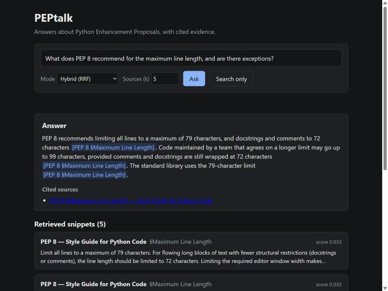
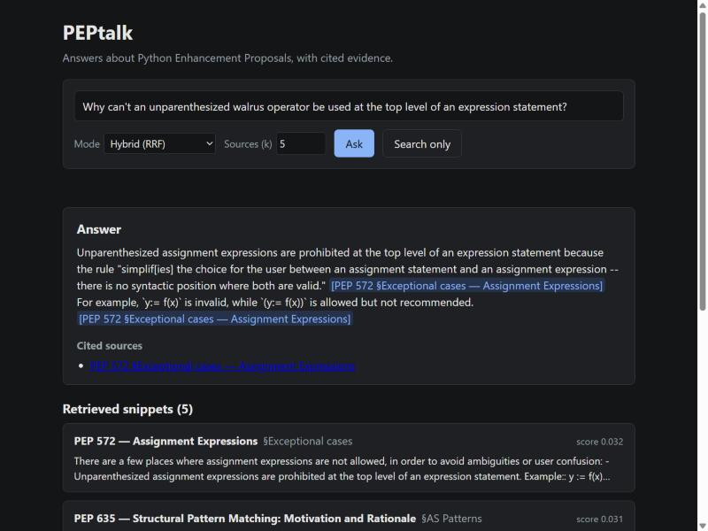

# Agensh × Claude Code × Claude Haiku 5.5: two team runs

**Date:** 2026-11-18 · **Harness:** [microsoft/Agensh](https://github.com/microsoft/Agensh) @ `2dae4e1`
([paper](https://arxiv.org/abs/2609.26781)) · **Worker:** Claude Code 2.1.327 (`--agent-harness claude`) ·
**Model:** `claude-haiku-5-5`, effort `high`, 100K context window, compaction at 80% · **Host:** WSL2 Ubuntu 24.04,
16 cores, 15.6 GB RAM, Docker 29.9

Every number in the tables below comes from `reports/stats.md`, which `python3 reports/collect_stats.py` generates from the
copied run records in `runs/<name>/`, or from the eval files named next to the number.

## Summary

Two Agensh teams of four Claude Code workers each built a working web application from a one-page goal, merging all work through
Agensh's CI gate.

| | **SkyBook** (plane tickets) | **PEPtalk** (RAG over Python PEPs) |
|---|---|---|
| Goal | [plane-tickets/goal.md](../plane-tickets/goal.md) | [rag/goal.md](../rag/goal.md) |
| Start | empty repository, planning phase on | seed repo with 69 PEPs, self-organized |
| Wall-clock budget | 1.5 h (paused after 57 min, resumed for the remaining 33 min) | 1.5 h |
| PRs merged / delivered commits | 18 / 41 | 18 / 48 |
| Acceptance on the delivered head | pass, 228 tests | pass, 166 tests |
| Model requests (all `claude-haiku-5-5`, 0 HTTP errors) | 971 | 1010 |
| Cost (5-min vs 1-h cache-write pricing) | $1.73–$2.02 | $1.34–$1.58 |
| Manual check | full booking flow works in a browser (screenshots below) | answers with correct citations; retrieval and generation evals reproduce |

The two teams together cost **$3.07–$3.60**. The relay's own ledger is an upper bound for everything, including my verification calls: **$3.61** of a
$9.00 hard cap. Most tokens were prompt-cache reads: 90 M of ~100 M total ([stats.md](stats.md)).

## Setup and what had to be fixed

1. **Install on WSL2.** Agensh needs Linux, Docker, systemd, cgroup v2 and passwordless `sudo`
   ([REPRODUCE.md](https://github.com/microsoft/Agensh/blob/main/REPRODUCE.md#prerequisites)).
   - Everything ran as root (`wsl -u root`), so the scripts' `sudo -n` calls succeed without a sudoers change.
   - The `agensh.slice` memory slice and the reboot guard were installed as documented.
   - Unit tests: 81/81 pass. Four first failed because `tests/smoke/fake_upstream.py` treats port `0` as unset and falls back to
     8080, which an unrelated container held; `PORT=0` works around it.
2. **Workspace-scoped API key.** The key used here is not tied to a workspace, so the API returns 400 without an
   `anthropic-workspace-id` header. Agensh's egress proxy can only inject `Authorization: Bearer`.
   [`relay/anthropic_relay.py`](../relay/anthropic_relay.py) runs on the Docker host gateway (Agensh's documented "host-loopback relay"
   position). It adds the header and passes streams through; Agensh itself is unmodified.
3. **Hard spend cap.** Agensh's `max_model_tokens` counts only uncached input + output tokens (`scripts/usage_meter.py:177`). Here that was
   ~3% of all tokens, so it does not bound cost. The relay was extended to enforce a dollar cap:
   - it reserves each request's worst-case cost before forwarding and refuses with 403 when spent + reserved would exceed the cap;
   - it settles the actual cost from the response's `usage`;
   - it allows only `claude-haiku-5-5`.
   Tests: [`relay/test_anthropic_relay.py`](../relay/test_anthropic_relay.py), plus a live test of stream, non-stream, wrong-model and
   over-cap requests.
4. **CI command bug (mine, plane-tickets).**
   - Gitea Actions runs `bash -e`, so the `pr` check `…; python3 -m pytest -q; rc=$?; …` exited on pytest's "no tests collected"
     code 5 before the exit-code test ran.
   - The empty first `main` therefore failed. The driver logged `main fails at 4b53dca… only fix-main PRs merge`, and worker 1 fixed it within
     4 minutes with a `[fix-main]` smoke-test PR.
   - The RAG seed repository shipped a passing corpus test instead.

## Timeline

| UTC | SkyBook | PEPtalk |
|---|---|---|
| 13:01 | run starts; planning phase: only worker 1 wakes | |
| 13:03 | `[fix-main]` smoke test merged | |
| 13:08–13:26 | worker 1 merges skeleton + seed data, search, flight page with seats | |
| 13:29 | | run starts; all 4 workers awake within 101 s |
| 13:34–13:44 | | web UI, generation, `ask` CLI and eval harness merged in parallel |
| ~13:46 | **planning timeout**: workers 2–4 wake (2,809 s of the 5,400 s budget spent "waking") | |
| 13:47–13:54 | | dense + hybrid retrieval, retrieval results committed |
| 13:53–13:58 | mock payment validation, README, seat-map fix merged by workers 4 and 3 | |
| 13:58 | **paused by me**: RAG workers' embedding jobs pushed the 12.2 GB slice to ~11.3 GB | |
| 14:41 | | last merge (README with generation metrics) |
| 14:44 | | 15-minute wrap-up notice |
| 14:59 / 15:08 | | budget ends / delivered branch `agensh/20261118t132725z` |
| 15:09 | resumed with `HOURS=0.55`: fresh sessions, all 4 workers awake in 97 s | |
| 15:12–15:33 | confirmation / manage / cancel, checkout + mock payment, responsive fixes, journey tests merged | |
| 15:42 / 15:46 | budget ends / delivered `delivery.bundle` | |

## Delivered applications

### SkyBook (plane tickets)

FastAPI + Jinja2 + SQLite, 4,488 lines of Python (app + tests). 270 seeded flights over 15 airports. All seven goal features work in a browser:

| Search | Results | Fare + seat map |
|---|---|---|
|  |  |  |

| Passengers | Payment (non-test card declined) | Confirmed | Cancelled |
|---|---|---|---|
|  |  |  |  |

Checked beyond the screenshots:
- Lookup with a wrong last name returns 404 (`GET /api/bookings/{ref}?last_name=`).
- Booked seats appear in `taken_seats` and disappear after cancellation.
- Neither card number appears anywhere in the SQLite dump, so card data is not stored.
- One UX flaw: once a seat is chosen for every passenger, the remaining seats are disabled with the same strikethrough style as
  taken seats, so the map looks fully booked. The server's seat data is correct (50 of 156 economy seats taken on the flight
  tested).

### PEPtalk (RAG)

The pipeline: ingest (69 PEPs → 2,832 section chunks) → BM25 / fastembed `bge-small-en-v1.5` / reciprocal-rank-fusion hybrid → Claude Haiku 5.5 answer with
`[PEP N §section]` citations. It drops citations to PEPs that were not retrieved, and it abstains when the evidence is missing.
Size: 4,015 lines of Python and tests, an `ARCHITECTURE.md`, and an 86-question gold set (83 answerable).

| PEP 8 line length (hybrid) | Walrus at statement level (hybrid) |
|---|---|
|  |  |

The team's committed eval and my independent rerun on the delivered code (fresh venv, fresh index, generation through the capped relay):

| Metric (83 answerable questions; generation: all 86, hybrid, k = 5) | Team ([eval/results.md](../pep-rag-app/eval/results.md)) | Rerun ([retrieval](../runs/pep-rag/reproduced-retrieval-eval.md), [generation](../runs/pep-rag/reproduced-generation-eval.md)) |
|---|---|---|
| BM25 hit@1 / hit@5 / MRR | 0.867 / 0.988 / 0.918 | 0.867 / 0.988 / 0.918 |
| Dense hit@1 / hit@5 / MRR | 0.904 / 0.964 / 0.938 | 0.904 / 0.964 / 0.938 |
| Hybrid hit@1 / hit@5 / MRR | 0.940 / 1.000 / 0.963 | 0.940 / 1.000 / 0.963 |
| Citation accuracy (cited PEPs ⊆ gold) | 0.849 | 0.872 |
| Answer correct / partial (Claude judge) | 0.814 / 0.093 | 0.826 / 0.116 |

Retrieval is deterministic and reproduces exactly. Generation differs by about 1–3 points between the two runs, as expected from a sampled
model and judge. These numbers measure the system on **questions written by the same agents that built it** (see Limitations).

## Observations about Agensh with Haiku workers

- **The planning gate depends on an exact PR title.** With `planning = true`, the other workers wake only when a PR whose title starts
  with `[plan]` merges (`agensh/team_run.py:484`). Haiku did the planning work: an issue breakdown, then feature PRs. But it never used
  that title, so three workers idled for 45 of 90 minutes. Worker 1 consequently did most of SkyBook's work: 375 of 971 requests and
  943K of 1.45M output tokens ([stats.md](stats.md)). Two ways to fix it: match on an `ARCHITECTURE.md` change or an explicit
  board signal, or have the driver open the `[plan]` PR itself.
- **Self-organization worked without planning.** In PEPtalk, the four workers claimed separate issues within minutes: core ingest/BM25,
  generation, web, and eval. They merged 18 PRs with 0 `main` breakages, and each worker merged 3–6 PRs.
- **Idle tail.** PEPtalk's last merge was 18 minutes before the budget ended. In that stretch the driver's watchdog saw workers idle for 600+ s,
  with queued events still pending ("letting the queue wake it"). The goal was largely done, and nothing in the setup asks the team
  to stop early: `fixed_length` is off, but no worker closed issue #1.
- **Resource contention comes from the product, not the harness.** Each PEPtalk worker ran the app's dense embedding (about 1.3–2.9 GB
  per process) to test and evaluate its own changes. Four of them at once pushed the containers to ~11.3 GB of the slice's 12.2 GB
  (`MemoryMax=80%`, no swap). Agensh's `pause` and `resume` worked cleanly: the team pushed, its sessions were saved, the containers stopped, and it later
  resumed in fresh sessions with a project summary. Lower `WORKER_MEMORY` or a shared embedding cache would avoid the pause.
- **Cost profile.** Claude Code re-sends long, cached contexts, so ~90% of tokens were cache reads. At Haiku 5.5 prices, a
  4-worker team cost about $1.3–2.0 per 1.5-hour run.

## Limitations

- **One run per task, no baseline or control.** There is no single-agent or different-model comparison, so these runs show only that the
  setup works and what it produced, not that a team is better than one agent.
- **The eval set was written by the team.** Gold questions and reference answers come from the same agents that built PEPtalk, so the
  numbers are likely optimistic; a held-out, human-written question set would be needed for a real quality claim. The
  answer judge is Claude Haiku 5.5 itself.
- **SkyBook's conditions differ.** It ran in two segments with a 67-minute pause and fresh sessions after the resume, and
  its first 45 minutes had a single active worker. Its numbers are not comparable to PEPtalk's.
- **Cost is a range.** Agensh's usage ledger does not record cache TTL, so cost is shown for 5-minute writes (1.25×) and 1-hour
  writes (2×). Prices are from the claude-api pricing notes for Haiku 5.5, not from the billing console.
- **The SkyBook check was manual.** I clicked through one route (AMS → MAD, 2 passengers) plus the API checks above; there was no
  automated end-to-end test beyond the team's own 228 tests.

## Reproduce

See the [README](../README.md#reproduce) for the commands. Then:
- `bash runs/fetch_artifacts.sh` copies the run records;
- `python3 reports/collect_stats.py` regenerates [stats.md](stats.md) / `stats.json`;
- in `pep-rag-app/`: `python3 -m peptalk index && python3 -m peptalk.eval [--generate]`;
- in `plane-tickets-app/`: `pip install -r requirements.txt && python3 -m pytest -q && python3 -m skybook`.
